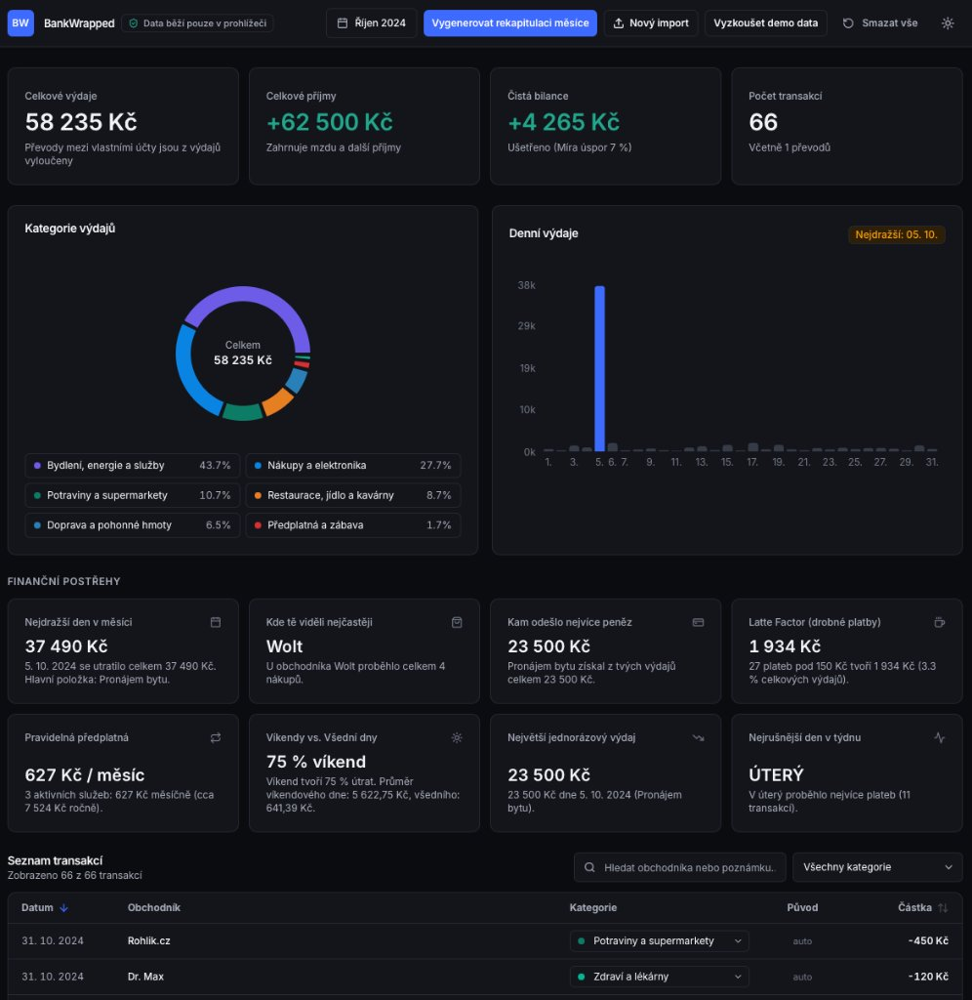

<div align="center">

# BankWrapped 💳

**100% Privacy-First Personal Finance Insights & Monthly Review Dashboard**

*Bezpečný klientský nástroj pro hloubkovou analýzu bankovních výpisů, vizualizaci útrat a tvorbu grafických měsíčních rekapitulací.*

[](https://www.typescriptlang.org/)
[](https://react.dev/)
[](https://vitejs.dev/)
[](https://tailwindcss.com/)
[](https://vitest.dev/)
[](#-architektura-a-z%C3%A1ruka-soukrom%C3%AD)
[](LICENSE)

[Klíčové funkce](#-kl%C3%AD%C4%8Dov%C3%A9-funkce) •
[Architektura & Soukromí](#-architektura-a-z%C3%A1ruka-soukrom%C3%AD) •
[Design systém](#-design-syst%C3%A9m-a-ux) •
[Rychlý start](#-rychl%C3%BD-start) •
[Testování](#-testov%C3%A1n%C3%AD) •
[Struktura projektu](#-struktura-projektu)

<br /><br />



</div>

---

## 📖 O projektu

**BankWrapped** je moderní jednostránková webová aplikace (SPA) zaměřená na přehlednou analýzu osobních financí s důrazem na špičkový fintech UX a **nekompromisní ochranu soukromí**.

Uživatel jednoduše přetáhne CSV bankovní výpis nebo spustí demo režim. Aplikace data v řádu desítek milisekund lokálně zpracuje, normalizuje, zkategorizuje a vykreslí interaktivní dashboard: rozložení nákladů, trendy denních výdajů, detekci předplatných i měsíční rekapitulační kartu (formát 9:16, 1080×1920 px) připravenou pro export do PNG.

---

## 🔒 Architektura a záruka soukromí

Finanční záznamy patří mezi nejcitlivější osobní data. BankWrapped proto funguje na principu nulové důvěry k externím serverům:

```mermaid
flowchart LR
    A["CSV soubor výpisu"] --> B["PapaParse / Web Worker (RAM)"]
    B --> C["Celočíselná normalizace (haléře)"]
    C --> D["Pravidlový Categorizer"]
    D --> E["Fintech Insights Engine"]
    E --> F["Reaktivní React Dashboard"]
    F --> G["1080×1920 PNG Exporter"]

    style A fill:#1e293b,stroke:#475569,stroke-width:1px,color:#f8fafc
    style B fill:#0f172a,stroke:#3b82f6,stroke-width:1px,color:#f8fafc
    style C fill:#0f172a,stroke:#3b82f6,stroke-width:1px,color:#f8fafc
    style D fill:#0f172a,stroke:#3b82f6,stroke-width:1px,color:#f8fafc
    style E fill:#0f172a,stroke:#3b82f6,stroke-width:1px,color:#f8fafc
    style F fill:#0f172a,stroke:#10b981,stroke-width:1px,color:#f8fafc
    style G fill:#0f172a,stroke:#10b981,stroke-width:1px,color:#f8fafc
```



- **Žádný backend ani cloud:** Veškerý kód běží izolovaně v sandboxu prohlížeče.
- **Nulový síťový provoz:** Aplikace neobsahuje žádné analytické skripty, cookies, telemetrii ani sledovací trackery.
- **Content Security Policy (CSP):** V produkčním sestavení je aplikováno striktní pravidlo `default-src 'self'; connect-src 'none'`, které na úrovni jádra prohlížeče fyzicky blokuje odchozí síťová volání.
- **Lokálně bundlované fonty:** Používá se proměnný font **Inter Variable** bundlovaný přímo v aplikaci bez stahování z externích CDN.
- **Žádné ukládání výpisů:** Surové transakce se neukládají ani do `localStorage`. Do lokálního úložiště se ukládají pouze vámi vytvořená pravidla kategorií a preference motivu (světlý/tmavý). Tlačítko *„Smazat vše“* okamžitě smaže veškerý stav z paměti i disku.

---

## ✨ Klíčové funkce

### 1. Robustní import a profilování bank
- **Předpřipravené bankovní profily pro ČR:**
  - **Air Bank:** oddělovač `;`, desetinná čárka, formát data `DD/MM/YYYY`.
  - **Revolut:** oddělovač `,`, časová razítka ISO, automatické vyřazení neúspěšných plateb (`FAILED`).
  - **Česká spořitelna, ČSOB, Fio banka:** automatická detekce specifických českých hlaviček.
- **Univerzální mapovač sloupců:** Při nahrání neznámého CSV výpisu se otevře interaktivní dialog s náhledem dat pro snadné přiřazení sloupců (datum, částka, obchodník, měna, desetinný oddělovač). Mapování se automaticky zapamatuje pro příští import.
- **Podpora kódování:** Automatická detekce a odstranění UTF-8 BOM (`\uFEFF`) s bezpečným fallbackem pro Windows-1250.
- **Web Worker:** Pro soubory nad 1 MB se parsování automaticky přesouvá do Web Workeru na pozadí, takže uživatelské rozhraní nikdy nezamrzne.

### 2. Finanční matematika bez zaokrouhlovacích chyb
- **Výpočty v celých číslech (`amountMinor`):** Veškeré finanční částky jsou interně reprezentovány v haléřích (např. `-15000` = -150,00 Kč), což eliminuje známé chyby plovoucí řádové čárky v JavaScriptu (`0.1 + 0.2 !== 0.3`).
- **Očištění o vlastní převody (`transfer`):** Převody mezi vlastními účty jsou automaticky detekovány a vyřazeny z výdajů i příjmů, aby nezkreslovaly bilanci ani míru úspor.
- **Konzistentní refundace:** Kladné platby od dřívějších obchodníků (např. vrácení zboží) snižují výdaje dané kategorie a obchodníka, namísto aby se chybně započítávaly jako příjem.

### 3. Deterministická kategorizace s uživatelskými pravidly
- **10 sémantických kategorií:** Potraviny a supermarkety, Restaurace a kavárny, Doprava a PHM, Bydlení a energie, Předplatná a zábava, Nákupy a elektronika, Zdraví a lékárny, Příjmy a výplata, Převody, Ostatní.
- **Word-boundary regex matching:** Pravidla rozlišují hranice slov (např. zkratka `hm` nesedí na `pharmacy`, ale přesně zachytí obchod `H&M`).
- **Inline přepisování s okamžitou perzistencí:** Změna kategorie v tabulce nabízí volbu:
  - *Pouze tato transakce* (lokální ruční úprava).
  - *Všechny stávající i budoucí transakce obchodníka* (vytvoří pravidlo s vyšší prioritou a okamžitě přepočítá data).

### 4. Analytický fintech dashboard
- **Klíčové KPI ukazatele:** Celkové výdaje, celkové příjmy, čistá bilance a míra úspor v %.
- **Interaktivní Donut Chart (Recharts):** Zobrazuje procentuální podíl kategorií a kliknutím na segment či legendu okamžitě filtruje tabulku plateb.
- **Denní dynamika výdajů:** Sloupcový graf s vizuálně zvýrazněným nejdražším dnem v měsíci.
- **Fintech Insights karty:**
  - *Nejdražší den:* Datum, celková částka a největší uskutečněný nákup.
  - *Top obchodníci:* Přehled podle četnosti návštěv i celkového objemu útrat.
  - *Latte Factor:* Součet a procentuální podíl drobných plateb do 150 Kč.
  - *Předplatná:* Měsíční součet a roční projekce opakujících se služeb (Spotify, Netflix atd.).
  - *Víkendy vs. všední dny:* Srovnání denních průměrů a podílu útrat.
- **Vysokokapacitní tabulka transakcí:** Vyhledávání s 250ms debouncem, řazení podle data či částky, diskrétní barevné indikátory kategorií a stránkování.

### 5. Grafická rekapitulace měsíce (9:16 PNG export)
- Generování karty o rozměrech **1080×1920 px** optimalizované pro mobilní obrazovky.
- Správné české skloňování měsíců v lokativu (*„V říjnu jsi utratil celkem...“*).
- **Mód soukromí:** Přepínač pro okamžité zamaskování přesných cifer (`•••••• Kč`) pro bezpečné sdílení.
- **PNG exportér:** Stažení obrázku ve vysokém rozlišení s plnou podporou českých diakritických znaků přes `html-to-image`.

---

## 🎨 Design systém a UX

BankWrapped se řídí principy moderního produktového designu (inspirováno systémy Linear a Stripe):

- **Konec zbytečného „slopu“:** Žádné laciné barevné gradienty na pozadí, žádné nečitelné pastelové texty bez kontrastu, žádné nafouklé stíny ani dekorativní ikony v barevných kruzích.
- **Paleta design tokenů (`tokens.css`):**
  - **Světlý režim:** Pozadí `#F7F7F8`, karty `#FFFFFF`, primární text `#0F1115` (kontrast 14:1 vůči bílé).
  - **Tmavý režim:** Pozadí `#0B0C0F`, karty `#14161B`, primární text `#F2F3F5`.
  - **Akcent:** Kobaltová modř (`#2B59FF` / `#3D6BFF`) vyhrazená pouze pro klíčové interakce.
  - **Barvy kategorií:** 10 sytých, vzájemně odlišitelných odstínů otestovaných na barvoslepost.
- **Typografie a zarovnání:** Font **Inter Variable** s aktivovanou vlastností `font-variant-numeric: tabular-nums` – všechna čísla a částky drží přesný vertikální sloupec bez poskakování.
- **Nativní podpora formulářových prvků:** Nastaveno `color-scheme: dark / light` a odstraněny nekompatibilní systémové rámečky macOS menulist (`appearance: none`).

---

## 🛠️ Technologický stack

| Komponenta | Technologie | Verze / Poznámka |
|---|---|---|
| **Jádro UI** | React | 19.x (čistá klientská SPA bez SSR) |
| **Typový systém** | TypeScript | 5.9 (striktní mód, žádné `any`) |
| **Sestavení & HMR** | Vite | 8.x (Rollup bundler, manual chunk splitting) |
| **Stylování** | Tailwind CSS | 3.4 + CSS Custom Properties tokeny |
| **Grafy** | Recharts | 2.15 (responzivní SVG grafy) |
| **Parsování CSV** | PapaParse | 5.5 + Web Worker podpora |
| **Datum a čas** | date-fns | 4.1 (lokalizace `cs`) |
| **Generování PNG** | html-to-image | 1.11 (rastrování DOM do 1080×1920 PNG) |
| **Testovací framework** | Vitest + Testing Library | JSDOM prostředí, 48 unit testů |

---

## 💻 Rychlý start

### Požadavky na prostředí
- **Node.js:** 18.0.0 nebo novější (doporučeno Node 20 LTS nebo 22)
- **npm:** 9.0.0 nebo novější

### 1. Klonování a instalace
```bash
# Klonování repozitáře
git clone https://github.com/Andreyy05/BankWrapped.git
cd BankWrapped

# Instalace závislostí
npm install
```

### 2. Spuštění vývojového serveru
```bash
npm run dev
```
Aplikace se spustí na adrese [http://localhost:5173](http://localhost:5173) s aktivním Hot Module Replacement (HMR).

### 3. Produkční sestavení a náhled
```bash
# Kontrola typů TypeScript a produkční build
npm run build

# Lokální náhled produkčního sestavení
npm run preview
```

---

## 🧪 Testování

Projekt obsahuje sadu 48 automatizovaných jednotkových a integračních testů pokrývajících všechny kritické výpočetní i UI moduly:

```bash
# Jednorázové spuštění testů
npm test

# Spuštění testů v režimu sledování změn (watch mode)
npx vitest
```

### Pokrytí testů
- **`parser.test.ts` (15 testů):** Odstranění BOM, autodetekce oddělovačů (čárka, středník), parsování Air Bank, Revolut, ČSOB, Česká spořitelna, čištění názvů obchodníků, normalizace částek v haléřích.
- **`categorizer.test.ts` (8 testů):** Shoda klíčových slov se slovními hranicemi, priorita uživatelských pravidel před vestavěnými, detekce předplatných, stabilita hashů.
- **`insights.test.ts` (14 testů):** Výpočet čisté bilance, vyloučení převodů, vliv refundací, míra úspor, detekce nejdražšího dne, výpočet Latte faktoru a projekce předplatných.
- **`demoData.test.ts` (7 testů):** Validace integrity 63 ukázkových transakcí, formáty dat, nenulové částky, existence alespoň 5 různých kategorií.
- **`wrapped.test.ts` (3 testy):** Validace 9:16 proporcí, skloňování měsíců v lokativu a správné formátování částek.
- **`App.test.tsx` (1 test):** Kompletní renderovací smoke test hlavní aplikace v JSDOM prostředí.

---

## 📁 Struktura projektu

```
BankWrapped/
├── .gitignore              # Ignorování CSV, buildů, .env a systémových souborů
├── index.html              # Vstupní HTML šablona s CSP meta tagem
├── package.json            # Definice skriptů a závislostí
├── tailwind.config.js      # Mapování design tokenů na Tailwind třídy
├── tsconfig.json           # Striktní TypeScript konfigurace
├── vite.config.ts          # Vite konfigurace s rozdělením chunků
├── vitest.config.ts        # Nastavení testovacího prostředí Vitest (JSDOM)
│
├── public/                 # Statické soubory (favicon, ikony)
│
└── src/
    ├── main.tsx            # Vstupní bod React aplikace
    ├── App.tsx             # Hlavní layout aplikace a sticky navigační lišta
    │
    ├── components/
    │   ├── ui/             # Znovupoužitelné UI prvky (Button, Badge, Card, Skeleton)
    │   ├── dashboard/      # Donut graf, denní sloupcový graf, KPI, tabulka, filtry
    │   ├── import/         # Drag-and-drop CSV Dropzone a Column Mapping modal
    │   └── wrapped/        # 9:16 exportní karta Monthly Wrapped a PNG generátor
    │
    ├── data/
    │   ├── categories.ts   # Definice 10 kategorií, barev a klíčových slov
    │   └── demoData.ts     # Realistická anonymizovaná demo data (říjen 2024)
    │
    ├── hooks/
    │   ├── useTransactions.ts  # Stavová logika pro filtrování, řazení a stránkování
    │   ├── useDebounce.ts      # 250ms debounce pro vyhledávací pole
    │   └── useTheme.ts         # Přepínání a perzistence světlého / tmavého motivu
    │
    ├── i18n/
    │   └── cs.ts           # Kompletní česká lokalizace, formátování měn a skloňování
    │
    ├── lib/
    │   └── utils.ts        # Spojování Tailwind tříd (clsx + tailwind-merge)
    │
    ├── services/
    │   ├── parser.ts       # CSV dekodér, detekce bank a parsovací logika
    │   ├── categorizer.ts  # Pravidlový categorizer s podporou uživatelských pravidel
    │   ├── insights.ts     # Analytický engine pro výpočet fintech metrik
    │   └── storage.ts      # Správa lokálního úložiště pro pravidla a nastavení
    │
    ├── styles/
    │   └── tokens.css      # Globální design tokeny pro světlý a tmavý režim
    │
    ├── types/
    │   └── index.ts        # Striktní typové definice transakcí a profilů
    │
    └── workers/
        └── parser.worker.ts# Web Worker pro asynchronní parsování velkých CSV
```

---

## 📄 Licence

Tento projekt je poskytován pod svobodnou licencí [MIT](LICENSE). Můžete jej volně používat, modifikovat a šířit v souladu s licenčními podmínkami.
